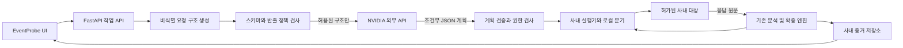

# ARTEX 참고 기반 EventProbe 확장 검토

검토일: 2026-10-13. EventProbe 기준 커밋: `fa065a1`.
참고 소스: `D:\ARTEX-main\ARTEX-main`의 현재 파일. ARTEX에는 로컬 수정이 있을 수 있으므로 upstream 전체와 동일하다고 가정하지 않았다.

## 결론

Python/FastAPI를 유지하고, EventProbe 안에 독립된 **자율 검증 작업 화면과 실행 모듈**을 추가하는 방향을 권장한다. 기존 분석 엔진을 재사용하고 ARTEX의 작업 관리, 증거 탐색, 중단/재개 UX를 참고한다.

NVIDIA 외부 추론 API만으로도 계획 생성은 가능하다. 다만 사용자가 지정한 정보 경계에서는 **외부 AI가 비식별 요청 구조로 조건부 계획을 만들고, 사내 실행기가 실제 응답을 판정해 분기하는 구조**가 적합하다. 응답을 계속 모델에 전달하는 ARTEX식 실행 루프를 그대로 적용하면 요구사항과 충돌한다.

현재 EventProbe는 응답 분석 옵션을 꺼도 다른 AI 경로로 요청 값이나 응답 유래 증거를 보낼 수 있다. UI 개편보다 이 경계의 서버 측 강제가 먼저다. 아래 내용은 코드에서 확인한 전송 가능 경로이며, 실제 사내 데이터가 유출됐다는 판정은 아니다.

## 확정한 요구사항과 검토 범위

- NVIDIA 외부 API 사용. 사내 GPU나 로컬 모델 도입은 현재 전제로 두지 않는다.
- 대상 도메인/IP, 실제 응답 본문, 응답에 포함된 내부 정보는 외부 AI 입력에서 제외한다.
- 요청 URI와 헤더는 비식별 처리된 구조만 허용한다. 원본 URI나 모든 헤더 값이 안전하다는 뜻은 아니다.
- 요청 본문의 업무 값, 인증정보, 개인정보, 내부 문서 역시 허용된 정보에 포함시키지 않는다.
- 상태코드, 탐지 라벨, 판정 결과 같은 응답 파생 정보는 이번 답변에서 명시적으로 허용되지 않았다. 권장 기본 모드에서는 이것도 외부로 보내지 않는다. 향후 필요하면 고정된 필드별 정책으로 별도 정의한다.
- 현재 제품 코드와 설정은 수정하지 않았다. 실제 타깃 요청이나 NVIDIA 추론 호출도 하지 않았다. `.env`, ARTEX의 실제 설정/키/데이터베이스 내용은 읽지 않았다.
- UI 검토는 소스와 ARTEX 동봉 스크린샷을 기준으로 했다. 실제 실행 화면의 브라우저 검증은 수행하지 않았다.

## 우선 발견사항

### F1. [P1] 응답 상세 분석 OFF가 응답 증거의 외부 전송을 막지 않음

근거: [AI 종합 판정 기본값](C:/Users/lsh/Downloads/dev/EventProbe/backend/core/ai_analyzer.py:108), [판정 문맥 구성](C:/Users/lsh/Downloads/dev/EventProbe/backend/routers/api.py:451), [findings 직렬화](C:/Users/lsh/Downloads/dev/EventProbe/backend/core/ai_analyzer.py:500).

`AI_RESPONSE_ANALYSIS`는 상세 분석만 제어한다. 별도 `AI_VERDICT`는 키가 있으면 기본 활성화되고, `findings`의 `why`, `evidence` 및 과거 요약을 AI 문맥에 넣는다. 이 근거에 응답 발췌나 내부 식별자가 들어 있으면 응답 원문을 직접 전달하지 않아도 반출된다. 자동 enrich 흐름에서도 이 경로를 사용한다.

조치: 외부 모드에서는 응답 유래 판정 설명을 로컬 템플릿으로 만든다. 공통 외부 전송 정책이 모든 AI 호출을 검사하도록 하고, UI 옵션이나 개별 기능 플래그로 우회할 수 없게 한다.

### F2. [P1] 호스트 제거와 민감 헤더 목록만으로 도메인/업무 값이 제거되지 않음

근거: [_blurred_request](C:/Users/lsh/Downloads/dev/EventProbe/backend/routers/api.py:222), [헤더 필터](C:/Users/lsh/Downloads/dev/EventProbe/backend/core/ai_privacy.py:17), [후보 생성](C:/Users/lsh/Downloads/dev/EventProbe/backend/core/ai_analyzer.py:348), [공격 분류](C:/Users/lsh/Downloads/dev/EventProbe/backend/core/ai_analyzer.py:584).

`_blurred_request`는 호스트를 제외하지만 쿼리 문자열과 요청 body를 유지한다. 후보 생성/분류도 파라미터 값과 body를 전달한다. 헤더 필터는 `Host`, `Cookie`, `Authorization` 등을 제거하는 차단 목록이며 `Origin`, `Referer`, `X-Forwarded-Host`와 임의의 사내 헤더 값을 일반적으로 제거하지 않는다. 도메인은 쿼리의 URL 값, body, 경로 세그먼트에도 존재할 수 있다.

조치: 원문에서 일부를 지우는 방식 대신, 허용된 필드만 포함하는 새 `PublicRequestShape`를 생성한다. 동적 경로, 필드명, 헤더명도 허용 목록과 타입 검증을 거친다. 알 수 없는 형식은 전송 거부한다.

### F3. [P1] RAG는 문서와 검색 질의를 별도 임베딩 API로 전송할 수 있음

근거: [임베딩 설정과 POST](C:/Users/lsh/Downloads/dev/EventProbe/backend/core/rag.py:136), [색인 시 문서 청크 전송](C:/Users/lsh/Downloads/dev/EventProbe/backend/core/rag.py:415), [검색 질의 전송](C:/Users/lsh/Downloads/dev/EventProbe/backend/core/rag.py:526), [질의에 근거 포함](C:/Users/lsh/Downloads/dev/EventProbe/backend/routers/api.py:349).

벡터 파일을 로컬에 저장해도 문서의 벡터 생성과 질의 임베딩은 외부에서 수행될 수 있다. 질의에는 finding의 설명/증거가 포함될 수 있다. 채팅 URL만 사내 주소로 바꾸거나 AI 종합 판정만 끄는 것으로 임베딩 경로가 차단되지 않는다. 검색된 문서 발췌가 채팅 프롬프트로 들어가는 경로도 별도로 존재한다.

조치: 내부 문서는 로컬 BM25 또는 사내 임베딩으로만 검색한다. 공개 지식과 내부 자료는 출처와 반출 등급을 분리한다. 외부 모델에는 공개 자료로 확인된 지식만 제공한다. 엄격 모드에서는 응답에서 만든 검색 질의도 외부 임베딩을 금지한다.

### F4. [P1] 기존 에이전트의 공유 OFF도 요청 구조만 전달하는 모드가 아님

근거: [planner 전송](C:/Users/lsh/Downloads/dev/EventProbe/backend/core/agent.py:181), [context 구성](C:/Users/lsh/Downloads/dev/EventProbe/backend/core/agent.py:354), [객체 정책 모델](C:/Users/lsh/Downloads/dev/EventProbe/backend/core/agent_models.py:33).

`share_response_context=False`는 응답 발췌만 제외한다. 목표 자유 텍스트, 계정 라벨, 객체의 `identity_value`와 설명, 이전 행동, 검증 결과는 여전히 planner에 제공된다. 경로 자체에 식별자가 있을 수도 있다. UI에서 공유 체크를 켜면 응답 일부를 보낼 수도 있어 기업 정책을 강제하는 경계가 아니다.

조치: 외부 모드의 계획 입력은 첫 관측 이전에 생성한다. 실행 중의 응답/검증 결과는 로컬 분기 엔진으로만 전달한다. 사용자 목표는 로컬에서 목적 코드로 정규화하고 객체/계정/엔드포인트는 임의 ID로 치환한다. 원본 매핑은 사내에만 보관한다.

### F5. [P1, 관련 기능 사용 시] AI 외의 네트워크 경로도 반출 통제가 필요함

근거: [OOB 경고 함수](C:/Users/lsh/Downloads/dev/EventProbe/backend/core/oob.py:273), [에이전트 OOB 발급](C:/Users/lsh/Downloads/dev/EventProbe/backend/core/agent.py:513), [브라우저 캡처](C:/Users/lsh/Downloads/dev/EventProbe/backend/core/capture.py:48).

OOB는 설정해야 활성화되지만, 공개 서버를 선택하면 콜백이 외부로 나간다. 기존 내부 대상 감지는 이름 기반 휴리스틱이며 경고 함수다. 에이전트의 OOB 발급에는 사내 수집기만 허용하는 강제 조건이 보이지 않는다. 일반 브라우저 캡처는 페이지가 요청하는 외부 리소스에 대한 범위 필터가 없다. 별도의 XSS 확증 경로에는 동일 출처 필터가 있으나 일반 캡처와 공통 정책은 아니다.

조치: 사내 OOB 수집기만 허용하고 없으면 해당 검사를 `미검증` 처리한다. 워커와 검증용 브라우저의 네트워크를 허가된 대상/사내 서비스로 제한한다. 에이전트 실행 범위에는 호스트뿐 아니라 포트, DNS 해석 결과, 리다이렉트, 경로와 메서드 정책을 적용한다.

### F6. [P2] 사내 다중 사용자 운영에 필요한 저장/접근 경계가 부족함

근거: [선택형 접근 토큰](C:/Users/lsh/Downloads/dev/EventProbe/backend/main.py:35), [원문 증거 저장](C:/Users/lsh/Downloads/dev/EventProbe/backend/core/agent.py:340), [SQLite 저장](C:/Users/lsh/Downloads/dev/EventProbe/backend/core/agent_store.py:15), [브라우저 기록](C:/Users/lsh/Downloads/dev/EventProbe/frontend/static/js/app.js:4923).

에이전트 기록은 로컬 SQLite에 요청/응답을 JSON으로 저장한다. 원문 body에 있는 자격증명까지 제거하는 기능은 아니다. 수동 요청 기록은 헤더/body를 브라우저 localStorage에 저장한다. 접근 토큰이 비어 있으면 인증이 꺼지며, 공유 토큰만으로 작업별 권한을 구분하지 않는다. 실제 배포의 인증 설정은 확인하지 않았다.

조치: 서버 인증과 작업 소유권, 세션 비밀정보 보관소, 암호화된 증거 저장, 보존 기간과 삭제 정책, 감사 기록을 설계한다. 로컬에 남겨도 되는 증거와 브라우저에 오래 남기면 안 되는 자격증명을 구분한다.

### F7. [P2] 검증 실행 환경과 의존성 선언 보완 필요

선택한 기존 테스트 4개 파일은 수집 단계에서 `numpy`, `cryptography` 모듈 부재로 중단됐다. `numpy`는 requirements에 있으나 이 Python 환경에는 설치되지 않았다. `cryptography`는 [oob.py](C:/Users/lsh/Downloads/dev/EventProbe/backend/core/oob.py:28)가 직접 import하지만 [requirements.txt](C:/Users/lsh/Downloads/dev/EventProbe/requirements.txt)에 선언되어 있지 않다. `agent`가 `oob`를 import하므로 OOB 기능을 꺼도 이 의존성이 필요하다.

개발 착수 시 격리된 가상환경, 직접 의존성 선언, 재현 가능한 버전 관리부터 정리한다.

## 요구사항별 권장안

| 요구 | 판단 | 권장 구현 |
| --- | --- | --- |
| 1. ARTEX 같은 UI | 가능. UI는 Go와 독립적 | 작업 중심 내비게이션, 표/필터, 실행 타임라인, 증거 상세 패널 |
| 2. 적절한 개발 스킬 | 기존 설치 스킬로 시작 가능 | 보안, UI 기준, Python 테스트, 모델 평가를 적용. UI 구현 시 Playwright 검증 |
| 3. NVIDIA 추론 API만 사용 | 가능. 학습이나 모델의 직접 실행 권한은 불필요 | 검증 가능한 JSON 계획 생성 후 Python이 도구 실행 |
| 4. 내부 정보 반출 금지 | 현재 구현으로는 충족하지 못함 | 비식별 요청 스키마만 외부로 전달. 원문 응답과 분기는 사내 처리 |
| 5. Go와 Python 차이 | Go 재작성 불필요 | FastAPI, Pydantic, 기존 분석/확증 모듈 재사용 |
| 6. 별도 기능으로 추가 | 화면/실행 모듈은 분리, 제품과 분석 코어는 통합 권장 | 같은 저장소와 인증/증거 체계. 운영 환경에서는 AI 게이트웨이와 실행 워커를 분리 |
| 7. 추가 개선 | 증거 품질과 통제 가능한 자동화 우선 | 승인된 검증 절차, 정책별 범위, 요청 예산, 감사 가능한 AI 전송 내역 |

## 데이터 경계

URI는 자동으로 비식별 정보가 되지 않는다. 예를 들어 `/users/12345`의 실제 ID나 `?redirect=https://...`의 호스트는 제거해야 한다. 헤더도 이름과 값의 정책을 따로 적용한다.

| 데이터 | 외부 AI 정책 | 내부 처리 |
| --- | --- | --- |
| 실제 도메인/IP/포트, 전체 URL | 금지 | 대상 레지스트리와 실행기에서만 사용 |
| 승인된 정적 경로와 템플릿 | 허용 | `/api/orders/{object_id}`처럼 동적 값 제거. 사내 명칭도 민감하면 endpoint ID만 사용 |
| Query/body 필드 | 허용된 구조/타입만 | 실제 값은 내부 유지. 불명확한 이름은 `field_1` 같은 별칭 |
| 요청 헤더 | 허용된 이름과 제한된 표준 값만 | 인증/쿠키/도메인 포함 값 금지. `Content-Type`도 표준 MIME로 정규화 |
| 응답 본문/응답 헤더/HAR/스크린샷 | 금지 | 사내 증거 저장소에 보관 |
| 응답 요약/발췌/임베딩/증거 설명 | 금지 | 요약과 임베딩도 반출 경계에 포함 |
| 응답 유래 상태/고정 판정 플래그 | 기본 금지 | 향후 허용 여부를 별도 정책으로 결정 |
| 자유 텍스트 목표, 계정명, 객체 식별값 | 원문 금지 | 목적 코드와 무작위 별칭으로 치환 |
| 공개 검증 지식/검증 절차 설명 | 허용 | 내부 문서와 별도 분류 |
| AI 제공자용 API 키 | 제공자 인증 전송만 | 서버 비밀정보로 관리. 대상 인증정보와 분리 |

비식별 별칭은 원문의 단순 해시보다 실행별 임의 ID와 내부 매핑을 권장한다. 낮은 엔트로피의 원문은 해시로도 추측할 수 있고, 같은 해시는 작업 간 연결을 노출한다.

정규식 마스킹은 추가 탐지 장치로 사용한다. 외부 AI를 호출해 원문을 비식별화하거나, 정제 실패 시 원문으로 재시도하는 흐름은 허용하지 않는다.

## 권장 구조



AI에는 실행 결과를 되돌려 보내는 화살표가 없다. 공개 조건부 계획 안의 `predicate_id`를 로컬 판정기가 평가하고 다음 `action_id`를 선택한다. 모델이 반환한 임의 코드를 `eval`하거나 셸에서 실행하지 않는다.

1. 사용자가 이벤트/요청과 허용 범위, 계정, 검증 목적을 지정한다.
2. 사내 파서가 비식별 요청 구조를 생성하고 허용된 검증 절차 목록과 함께 외부 AI에 전달한다.
3. AI는 순서와 조건을 가진 제한된 JSON 계획을 반환한다. 도메인, 실제 계정 정보, 응답을 알 필요가 없다.
4. Python이 스키마, 존재하는 action/endpoint/actor ID, 예산, 위험 등급을 검사한다.
5. 실행기는 내부 매핑으로 실제 요청을 구성하고 기존 분석/확증 엔진으로 증거를 판정한다.
6. 결과에 따른 분기는 내부에서 처리한다. 알려지지 않은 상황은 `미확정` 또는 승인 대기로 남긴다.
7. UI는 응답 증거, 계획의 진행 상태, 판정 근거를 사내에서 표시한다.

초기 운영은 승인된 절차 ID와 제한된 입력 조합 위주로 시작하는 편이 좋다. 자유 형식 페이로드나 범용 Bash/MCP 실행을 넣으면 통제해야 하는 범위가 크게 늘어난다. 필요하면 검증된 도구 어댑터를 개별적으로 추가한다.

응답을 읽지 않는 외부 AI는 예상하지 못한 업무 로직, 새 응답 형식, 복잡한 다단계 관계를 즉석에서 해석할 수 없다. 따라서 ARTEX와 동일한 자율 해결률을 약속할 수 없다. 정해진 이벤트 유형의 재현, 대조군 비교, 재검증, 결과 정리는 충분히 자동화할 수 있다. 더 넓은 적응형 추론은 사내 모델 또는 명시적으로 허용된 응답 파생 필드가 필요하다.

### 반출 정책의 강제 지점

- 채팅, 에이전트, 임베딩, 보고서 등 모든 외부 AI 호출을 단일 정책 경로로 모은다. raw HTTP 결과를 받는 함수가 직접 제공자 API를 호출하지 못하게 한다.
- 운영에서는 AI 게이트웨이와 실행 워커를 서로 다른 권한/네트워크 경계로 실행한다. 워커는 NVIDIA 키와 인터넷 직접 접근 권한이 없고, AI 게이트웨이는 원문 증거 DB와 타깃 인증정보를 읽을 권한이 없다.
- 게이트웨이는 원문 문자열/임의 JSON을 받지 않고 제한된 DTO만 받는다. 제공자 목적지 허용 목록은 데이터 내용 검사를 대신하지 못하므로 둘 다 필요하다.
- 재시도, 오류 보고, 외부 로그/추적 SDK, 브라우저 리소스와 OOB까지 포함해 반출 경로를 확인한다. 브라우저에서 NVIDIA API를 직접 호출하지 않는다.
- 이미 정제된 실제 전송 본문, 정책 버전, 모델 버전, 전송 시각을 사내 감사 기록으로 남긴다. 탈락한 민감 원문을 일반 로그에 다시 기록하지 않는다.
- 테스트한 경계와 배포 환경에서 금지 데이터 전송을 차단한다는 검증 목표를 세운다. 설정 한 개나 정규식만으로 모든 유출 가능성이 사라진다고 표현하지 않는다.

## Python과 기존 기능의 재사용

현재 버전에는 이미 단순 요청/응답 분석 이상의 기반이 있다.

| 기존 구성 | 재사용할 점 | 필요한 변경 |
| --- | --- | --- |
| `core/agent.py` | 단계 실행, 시간/요청/AI 예산, 중단/재개, 계정 세션 | 외부 planner에 응답 context를 넘기는 루프를 조건부 계획 + 로컬 분기로 변경 |
| `core/agent_models.py` | Pydantic 계약, 같은 출처 검증, 알려진 행동 종류 | 비식별 입력, 계획 DSL, 작업별 범위/위험 정책 |
| `core/analyzer.py`, `confirm.py`, `test_validity.py` | 증거 기반 탐지, 차등 확인, 유효성 검증 | 수동/자동 모드가 같은 판정 서비스 사용 |
| `core/agent_store.py` | 실행과 증거의 지속 저장, 재시작 복구 상태 | 접근제어, 보존정책, 세션 비밀정보 분리 |
| `routers/agent.py` | 생성/조회/중단/재개 API | 목록 필터, 승인 상태, 증거 지연 조회, 진행 이벤트 |
| `frontend/static/js/agent.js` | 실행 UI와 API 연결 | 큰 모달에서 작업 전용 페이지로 확장 |

단일 사용자 초기 버전은 SQLite와 단일 실행 프로세스로 유지할 수 있다. 현재 `asyncio.create_task`와 메모리 세션을 그대로 둔 채 Uvicorn worker 수만 늘리면 작업 제어/복구가 일관되지 않는다. 다중 사용자와 독립 워커가 필요해질 때 작업 큐, durable job claim, 프로세스 간 취소 신호, PostgreSQL을 도입한다. 재시작 후 쓰기 요청의 무조건 재실행은 피하고 처리 여부가 불명확하면 승인 대기로 둔다.

ARTEX의 Go 서비스 자체를 병렬로 붙이는 방안도 기술적으로 가능하지만 두 런타임, 별도 인증/DB, 도구 정책과 AI 문맥을 동시에 관리해야 한다. 현 요구에서는 기존 Python 코어를 중심으로 구성하는 쪽을 권장한다. 성능 병목은 측정 후 판단하며, HTTP I/O 위주라는 이유만으로 Go 이식이 필요하지는 않다.

## UI 방향

ARTEX의 [작업 화면](D:/ARTEX-main/ARTEX-main/screenshots/tasks.png), [트래픽 화면](D:/ARTEX-main/ARTEX-main/screenshots/traffic.png), [프런트 의존성](D:/ARTEX-main/ARTEX-main/web/package.json)을 확인했다. React/Next.js, Tailwind, shadcn 계열 구성요소, Lucide 아이콘을 사용한다. 참고할 요소는 단정한 내비게이션, 일관된 테이블, 상태 표시, 상세 화면 분리다.

권장 화면 구성:

- **이벤트 검증**: 기존 Raw HTTP/HAR 입력, 요청/응답 비교, 판정과 증거.
- **자율 검증**: 작업 표, 필터, 생성/중단/재개, 승인 대기, 요청 예산과 진행률.
- **작업 상세**: 범위와 목표, 실행 타임라인, 선택한 단계의 요청/응답/판정 근거를 함께 표시.
- **검증 결과**: 사건별 confirmed/suspicious/inconclusive 구분, 재현 여부와 한계, 내부 보고서.
- **정책/설정**: 대상 범위, 계정 참조, 반출 정책, 실제 AI 전송 내용, 공개 지식 관리.

UI 상태는 URL로 접근할 수 있게 하고, 자유 JSON 입력 대신 계정/객체 정책 폼을 제공한다. 대량 원문은 목록 API에 매번 포함하지 않고 증거를 펼칠 때 조회한다. 진행 상태는 SSE 또는 증분 폴링으로 갱신한다. 전체 이벤트를 2초마다 반환하는 현재 패턴은 작업이 커지면 부담이 된다.

프런트 전용 전환을 감수할 수 있다면 **React + TypeScript + Vite + shadcn/ui + Lucide**를 권장한다. FastAPI는 그대로 API와 정적 빌드 결과를 제공하면 되고, SSR이 필요하지 않은 사내 도구에 Next.js 서버를 추가할 필요는 없다. 작은 1차 변경은 기존 HTML/CSS로도 충분하다. UI 프레임워크 전환과 판정 엔진 재작성을 한 번에 수행하지 않는다. [FastAPI 정적 파일 문서](https://fastapi.tiangolo.com/tutorial/static-files/)

UI 코드에서 확인한 개선점:

- [index.html:37](C:/Users/lsh/Downloads/dev/EventProbe/frontend/templates/index.html:37): 사이드바 탭이 `div onclick` 형태다. 키보드 접근과 탭 상태를 지원하는 컨트롤로 바꾼다.
- [index.html:148](C:/Users/lsh/Downloads/dev/EventProbe/frontend/templates/index.html:148): URL 입력에 연결된 label/aria-label이 없다. placeholder 외에 접근 가능한 이름을 부여한다.
- [agent.js:7](C:/Users/lsh/Downloads/dev/EventProbe/frontend/static/js/agent.js:7): 장시간 작업의 핵심 화면이 모달이다. 실행 목록과 상세 페이지로 분리한다.
- [agent.js:20](C:/Users/lsh/Downloads/dev/EventProbe/frontend/static/js/agent.js:20): 응답 공유 체크박스는 고정된 회사 정책과 충돌할 수 있다. 서버 강제 정책을 표시하고 클라이언트에서 완화할 수 없게 한다.
- [style.css:88](C:/Users/lsh/Downloads/dev/EventProbe/frontend/static/css/style.css:88): `transition: all` 대신 바뀌는 속성을 명시한다.

UI 기준은 [Web Interface Guidelines](https://raw.githubusercontent.com/vercel-labs/web-interface-guidelines/main/command.md)를 참고했다. 구현 후 1440px, 1024px, 390px에서 긴 URI/증거, 빈 결과, 오류, 진행 상태, 키보드 이동을 검증한다. 브라우저 테스트는 합성 데이터와 모의 API를 사용한다.

## NVIDIA 추론 API 적합성

자율 실행에는 모델 자체의 HTTP 실행 권한이나 재학습이 필수인 것이 아니다. 모델은 다음 단계 또는 계획을 출력하고, 프로그램이 이를 검증해 실행한다. 현재 `choose_action`도 일반 chat completion 응답을 Pydantic `Action`으로 검증하는 구조다.

NVIDIA는 모델/배포별 tool calling과 구조화 출력을 문서화하고 있다. 하지만 NIM 컨테이너 문서의 기능이 모든 NVIDIA hosted 모델에 동일하게 제공된다고 가정하면 안 된다. 실제 사용할 모델 ID, API의 JSON/schema 지원, thinking 옵션, 출력 길이, 속도/호출 제한을 합성 데이터로 확인해야 한다. [NVIDIA Tool Calling](https://docs.nvidia.com/nim/large-language-models/1.15.0/function-calling.html), [Structured Generation](https://docs.nvidia.com/nim/large-language-models/1.15.0/structured-generation.html)

native tool calling 미지원 모델도 안정적인 JSON을 만들면 사용할 수 있다. 문법 오류에는 제한된 재시도 또는 승인된 기본 계획을 적용하고, 잘못된 출력은 실행하지 않는다. 현재 모델명 부분 문자열을 보고 thinking 옵션을 바꾸는 로직은 제공자/모델별 기능 설정으로 교체하는 것이 좋다. 모델의 비공개 추론 과정을 기록할 필요 없이, 짧은 계획 이유와 관측 가능한 실행 근거를 기록한다.

## 스킬 적용

개발 보조 스킬과 제품 안에서 실행하는 검증 절차는 구분한다. 개발 스킬을 설치했다고 런타임 에이전트에 실행 권한이나 데이터 보호가 자동으로 생기지는 않는다.

| 스킬 | 이번 적용 또는 후속 사용 |
| --- | --- |
| [security-best-practices](C:/Users/lsh/.codex/skills/security-best-practices/SKILL.md) | 이번 검토에 적용. Python/FastAPI, JS/React, Go의 데이터/인증/실행 경계 점검 |
| [web-design-guidelines](C:/Users/lsh/.codex/skills/web-design-guidelines/SKILL.md) | 이번 검토에 적용. 내비게이션, 접근성, 장시간 작업 화면 기준 |
| [llm-evaluation](C:/Users/lsh/.codex/skills/llm-evaluation/SKILL.md) | 이번 검토에 적용. 계획 품질과 증거 기반 판정의 별도 평가 설계 |
| [python-testing-patterns](C:/Users/lsh/.codex/skills/python-testing-patterns/SKILL.md) | 검증 기준 설계에 적용. 모의 전송과 비동기 실행의 격리 테스트 |
| [playwright](C:/Users/lsh/.codex/skills/playwright/SKILL.md) | 지침 확인. UI 구현 후 실제 브라우저 검증에 사용하며 이번에는 실행하지 않음 |

모두 이미 설치된 스킬이다. 추가 설치나 외부 서비스 연결은 수행하지 않았다. ARTEX의 제품용 skills, MCP, 범용 실행 도구를 그대로 가져오는 작업도 하지 않았다. 향후 제품용 검증 절차에는 버전, 허용 대상, 입력 스키마, 최대 요청 수, 위험 등급, 증거 조건을 선언한다.

## 개발 순서와 완료 기준

| 단계 | 범위 | 완료 기준 |
| --- | --- | --- |
| 0. 환경 재현 | 가상환경/직접 의존성 정리 | 기존 관련 테스트가 수집되고 실행됨 |
| 1. 반출 경계 | 비식별 DTO, 공통 게이트웨이, 채팅/임베딩 우회 차단 | 모든 외부 경로에서 금지 데이터가 검출되지 않고 부적합 입력은 차단됨 |
| 2. 작업 UI | 작업 표/상세, 기존 수동 검증 연결 | 입력부터 증거 조회와 재개까지 일관된 화면 흐름 |
| 3. 제한된 자율 검증 | 승인된 절차, JSON 계획, 로컬 분기 | 모델 도움 없이도 응답 판정과 중단 조건이 지켜짐 |
| 4. 사내 운영 | 워커 네트워크 분리, 인증/권한, 내부 OOB, 보존/감사 | 허용 범위 이탈과 원문 반출을 운영 환경에서도 차단 |

처음부터 다중 에이전트와 자율 셸을 도입할 필요는 없다. 단일 계획기와 제한된 병렬 실행으로 시작하고, 실제 병목이나 검증 범위가 확장될 때 늘린다. 검증 목적은 “사내 이벤트의 사실 확인”으로 두고, 결과 없음이나 예산 소진을 안전 판정으로 취급하지 않는다.

필수 검증 기준:

- 합성 도메인, IP, 이메일, 쿠키, JWT, body 비밀값, 응답 마커를 여러 필드에 넣고 실제 외부 전송 직전 본문/헤더를 검사한다. 채팅뿐 아니라 임베딩, 오류/재시도 경로를 포함한다.
- 인코딩된 URL, 중첩 JSON, form, XML, 도메인 포함 Referer/Origin, 객체 설명, 자유 목표, 내부 RAG 문서가 원문으로 빠져나가지 않는지 확인한다. 미지원 형식은 차단한다.
- 엄격 모드에서는 같은 비식별 요청 구조와 계획에 대해 응답의 내용만 바꿨을 때 외부 AI 전송 내용/추가 호출이 응답에 의해 달라지지 않는지 확인한다. 응답 유래 정보가 간접적으로 계획 입력에 섞이지 않도록 한다.
- 비정상 계획, 없는 ID, 범위 밖 URL, 위험한 메서드, 반복 동작, 시간/요청 예산, 취소/재시작을 모의 도구로 검증한다. GET도 상태 변경이 가능한 업무 시스템을 고려해 경로/절차 단위로 허용한다.
- 네트워크 정책과 캡처로 실행 워커의 외부 접속이 막히는지 검증한다. 단위 테스트 통과만으로 운영 환경 반출 차단을 입증했다고 하지 않는다.
- 모델 평가는 합성/공개 케이스로 JSON 유효율, 허용 계획 비율, 불필요 요청 수, 검증 완료율, 오탐/미탐, p95 지연과 호출 비용을 측정한다. 실제 수치는 아직 없다.
- 최종 판정은 로컬 증거와 사람이 검토한 기대 결과로 평가한다. 내부 응답을 외부 LLM-as-judge에 보내지 않는다.

## 라이선스

ARTEX 루트 [LICENSE](D:/ARTEX-main/ARTEX-main/LICENSE:1)와 README는 AGPL-3.0을 명시한다. 한편 [web/LICENSE](D:/ARTEX-main/ARTEX-main/web/LICENSE:1)에는 다른 저작권자의 MIT 표기가 있어 파일별 기원과 적용 범위를 확인해야 한다. UI 디렉터리 전체가 자유롭게 복사 가능한 별도 MIT 코드라고 단정하지 않는다.

AGPL 13조에는 수정본과 원격 네트워크 사용자에 대한 소스 제공 조건이 있다. 실제 재사용/결합 방식에 따른 범위는 따로 확인해야 한다. 이번 권장안은 작업 흐름과 일반적인 UI 패턴을 참고하고 EventProbe 쪽에 독립 구현하는 것이다. [GNU AGPL 공식 본문](https://www.gnu.org/licenses/agpl-3.0.en.html#section13)

## 실행한 확인과 한계

아래 기존 모의 테스트를 실행했으나 `numpy`/`cryptography` 부재로 4개 파일 모두 수집 오류가 발생했다. 테스트 본문은 실행되지 않았고 통과 판정도 없다.

```powershell
& 'C:\Users\lsh\AppData\Local\Programs\Python\Python311\python.exe' -m pytest backend/tests/test_ai_privacy.py backend/tests/test_agent.py backend/tests/test_rag_query.py backend/tests/test_rag.py -q
```

현재 privacy 테스트는 알려진 민감 헤더 제거를 확인한다. 도메인이 다른 필드에 있는 경우, 응답 유래 근거, 임베딩 경로, 목표/객체 정책까지 포함하는 새 반출 정책을 검증하지는 않는다. 에이전트 테스트도 모의 planner를 사용하므로 실제 NVIDIA 모델의 계획 품질을 증명하지 않는다.

검토 문서 외 제품 변경, 의존성 설치, 타깃 검사, 실제 AI 호출, UI 실행은 하지 않았다. 따라서 제안 구조의 운영 보안이나 모델 성능이 이미 검증됐다고 해석하면 안 된다.
